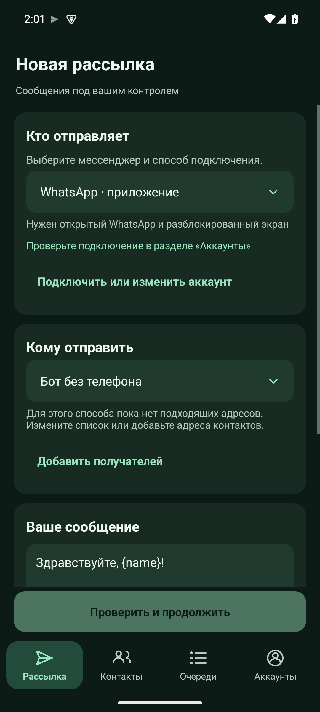
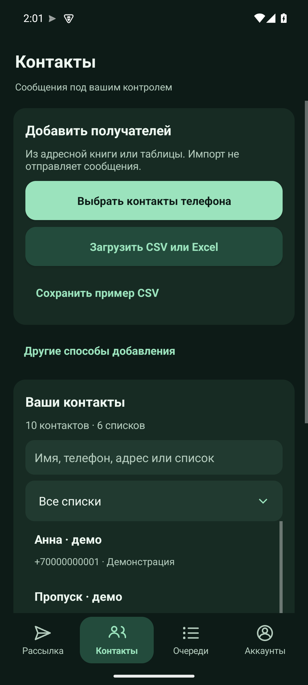
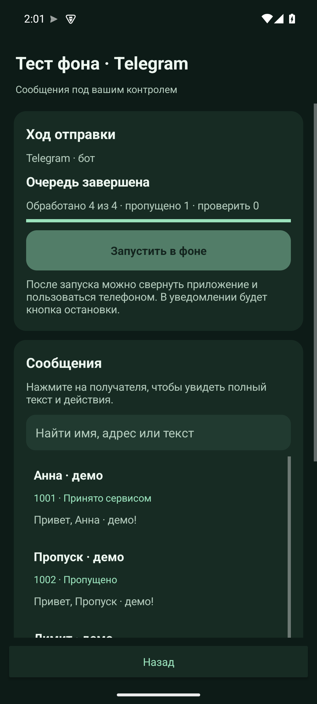
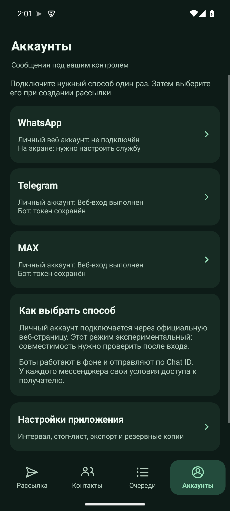
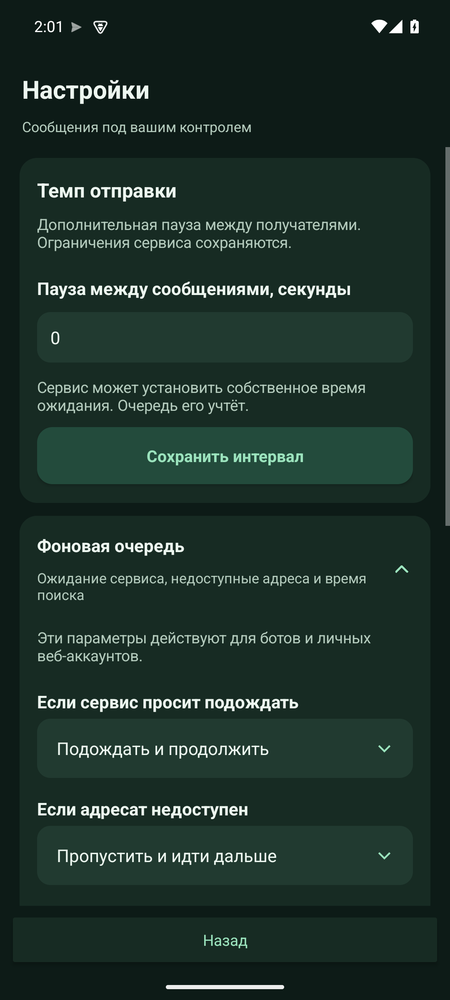

# Morcool Sender

Бесплатное Android-приложение с публичными исходниками для подготовки персональных сообщений, списков получателей и очередей WhatsApp, Telegram и MAX.

**Версия 1.1 — предварительная сборка.** Фоновые ботовые очереди проверены на изолированных эмуляторах. Личные веб-аккаунты пока экспериментальные: работу с настоящим аккаунтом необходимо проверить после входа.

[Сборки и релизы](https://github.com/coolmorimer/morcool-sender/releases) · [CSV-пример](sample.csv) · [Подробности проверки](VERIFICATION.md)

## Интерфейс

Основной маршрут отделён от продвинутых настроек. Снимки ниже сделаны на эмуляторе с демонстрационными контактами.

<p>
  
  
  
  
  
</p>

## Что умеет приложение

- Понятный маршрут: выбрать отправителя → список → написать сообщение → проверить → запустить.
- Импорт CSV и XLSX с выбором листа, колонок и списка; повторяющиеся адреса исключаются.
- Выбор нескольких контактов телефона, поиск, ручное добавление и заметки.
- Шаблоны с `{name}`, `{phone}` и полями таблицы, например `{order}`.
- Очереди с прогрессом, остановкой, причинами пропуска и CSV-отчётом.
- Стоп-лист и резервная копия контактов, шаблонов и истории.
- Светлая и тёмная темы, масштабируемый текст, отдельные продвинутые настройки.

## Способы отправки

| Способ | Работа в фоне | Что потребуется |
| --- | --- | --- |
| WhatsApp — приложение | Использует открытый экран WhatsApp | Установленный WhatsApp, разрешённая служба специальных возможностей, разблокированный экран |
| WhatsApp — личный веб-аккаунт | Экспериментальная веб-очередь | Вход на официальной веб-странице внутри приложения; проверка совместимости после входа |
| Telegram — личный веб-аккаунт | Экспериментальная веб-очередь | Вход внутри приложения; адрес получателя или доступный для поиска телефон |
| MAX — личный веб-аккаунт | Экспериментальная веб-очередь | Вход внутри приложения; адрес, поддерживаемый поиском веб-клиента |
| Telegram — бот | Фоновая служба с уведомлением | Токен бота и Chat ID доступного ему чата или имя канала |
| MAX — бот | Фоновая служба с уведомлением | Токен бота и `chat:ID` либо `user:ID` |

Фоновая API-очередь не открывает мессенджер поверх других приложений. Можно пользоваться телефоном; остановка доступна в приложении и уведомлении. Android и прошивка могут завершить службу — приложение сохраняет прогресс, но не обещает бесконечную работу после принудительной остановки.

Номер телефона не заменяет Chat ID бота. Доступ к получателю зависит от мессенджера: например, Telegram-бот обычно может писать пользователю после его обращения к боту. MAX-бот создаётся на платформе MAX для партнёров. Личный веб-режим не является интеграцией с MAX Open Client API; для прямого клиентского API MAX требуется отдельный доступ разработчика. Ссылки на документацию — в [SOURCES.md](SOURCES.md).

## Первый запуск

1. В разделе **Аккаунты** выберите личный веб-вход или добавьте токен бота. Пароли и коды вводятся только на странице самого мессенджера.
2. В **Контактах** выберите номера телефона или загрузите таблицу. Здесь же можно сохранить [CSV-пример](sample.csv).
3. В **Рассылке** выберите отправителя и список. Напишите текст, при необходимости используйте шаблон.
4. Нажмите **Проверить получателей и текст**. Этот шаг ничего не отправляет.
5. Проверьте сообщения и отдельно запустите очередь. Для фонового режима разрешите уведомления, чтобы была доступна остановка.

## Пример CSV

[Скачать sample.csv](sample.csv) — UTF-8 с BOM. Пример содержит искусственные данные; замените их перед использованием.

```csv
phone,name,order,telegram,max,telegram_chat_id,max_chat_id
+70000000000,Пример — замените данные,DEMO,,,,
```

| Колонка | Для чего нужна |
| --- | --- |
| `phone` | Международный телефон WhatsApp, например в формате `+7…` |
| `name` | Имя для подстановки `{name}` |
| `order` | Произвольное поле для подстановки `{order}` |
| `telegram` | Личный Telegram: `@username`, ссылка `t.me` или международный телефон |
| `max` | Личный MAX: ссылка или адрес для поиска в веб-клиенте |
| `telegram_chat_id` | Chat ID Telegram-бота или `@имя_канала` |
| `max_chat_id` | `chat:ID` или `user:ID` MAX-бота |

Необязательно заполнять адреса всех мессенджеров. При импорте выберите нужный тип адреса и колонку. Имена дополнительных колонок доступны как подстановки. Excel поддерживается в формате `.xlsx`; старый `.xls` предварительно пересохраните. Формулы не вычисляются — читается сохранённое в файле значение.

## Прогресс и результаты

«Принято сервисом» означает подтверждённый ответ API; «Нажата отправка» — подтверждённое действие интерфейса. Эти статусы не подтверждают доставку или прочтение.

Недоступные адресаты пропускаются с причиной в отчёте. Если ответ потерян после начала отправки, строка становится неопределённой и не повторяется автоматически. Перед ручным возвратом такой строки в очередь проверьте чат, чтобы избежать дубликата.

## Данные и разрешения

- Контакты, шаблоны и история хранятся в данных приложения. Сервер проекта не требуется.
- Ботовые токены шифруются с помощью Android Keystore и не включаются в экспорт или JSON-копию.
- Веб-вход сохраняется в данных Android WebView. В разделе аккаунтов доступен выход из веб-сессий.
- Доступ к контактам нужен при выборе номеров из телефонной книги; CSV и ручное добавление доступны отдельно.
- Специальные возможности нужны экранному способу WhatsApp. API-очереди их не используют.
- Для API MAX добавлен доверенный корневой сертификат с официального источника. Дополнительное доверие ограничено соединениями MAX, проверка имени сервера сохраняется; системное хранилище телефона не изменяется.

Резервные копии и отчёты содержат ваши контакты и сообщения. Сохраните копию перед удалением приложения или заменой данных.

## Совместимость и проверка

Заявленный минимум — **Android 6.0 / API 23**. Для личных веб-аккаунтов нужен подходящий Android System WebView. Это не гарантия работы на каждой модели и прошивке.

Проверены изолированные эмуляторы Android 15 / API 35 и Android 8 / API 26, а также светлая/тёмная тема и увеличенный шрифт. API-проверки выполнялись с локальным тестовым сервером, веб-проверки — с контролируемыми тестовыми страницами. Настоящие сообщения аккаунтам для проверки не отправлялись. Подробности и пределы подтверждения — в [VERIFICATION.md](VERIFICATION.md).

## Локальная сборка

Нужны PowerShell, JDK 17 или новее и Android SDK с `platforms;android-36` и `build-tools;36.0.0`.

```powershell
$env:JAVA_HOME = 'путь к JDK'
$env:ANDROID_SDK_ROOT = 'путь к Android SDK'
.\Build.ps1
```

Готовый файл: `Morcool-Sender-Next.apk`. Установка выполняется пользователем отдельно.

Сборка использует `ANDROID_SDK_ROOT` или `ANDROID_HOME` и `JAVA_HOME`. Необязательные параметры подписи: `MORCOOL_KEYSTORE`, `MORCOOL_KEYSTORE_PASSWORD_FILE`, `MORCOOL_KEY_ALIAS`. Можно задать локальный `local.build.json` с полями `SdkRoot`, `JdkHome`, `Keystore`, `PasswordFile`, `KeyAlias`. Этот файл исключён из Git.

В новом клоне сборщик создаёт локальный ключ и файл пароля в исключённой папке `keys/`. Сохраните свой ключ: для обновления поверх уже установленного приложения нужна та же подпись. Ключ установленной авторской сборки в репозиторий не включён.

## Изолированные тесты

`Build.ps1 -Qa` создаёт QA-сборку с локальными тестовыми маршрутами; `Build-Tests.ps1` собирает instrumentation APK. Тестовый сервер `tests/mock_server.py` слушает только loopback и не пересылает сообщения в мессенджеры.

Используйте отдельный эмулятор и всегда указывайте его serial в командах ADB. Instrumentation перезапускает целевое приложение, поэтому его нельзя запускать на устройстве с работающей рассылкой. Обычная сборка не включает QA-маршруты.

Приложение самостоятельно разработано и не является продуктом WhatsApp, Telegram, MAX или WB Sender.

## Лицензия

Исходный код распространяется по [MIT](LICENSE). Обозначения мессенджеров принадлежат их правообладателям; это независимое приложение.
